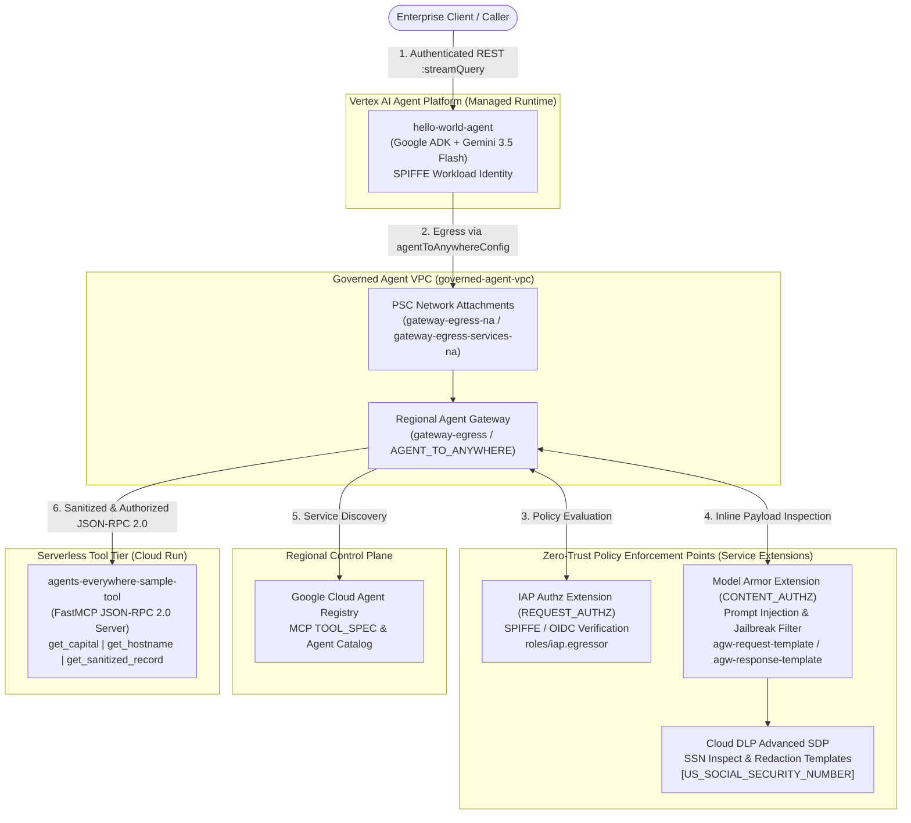
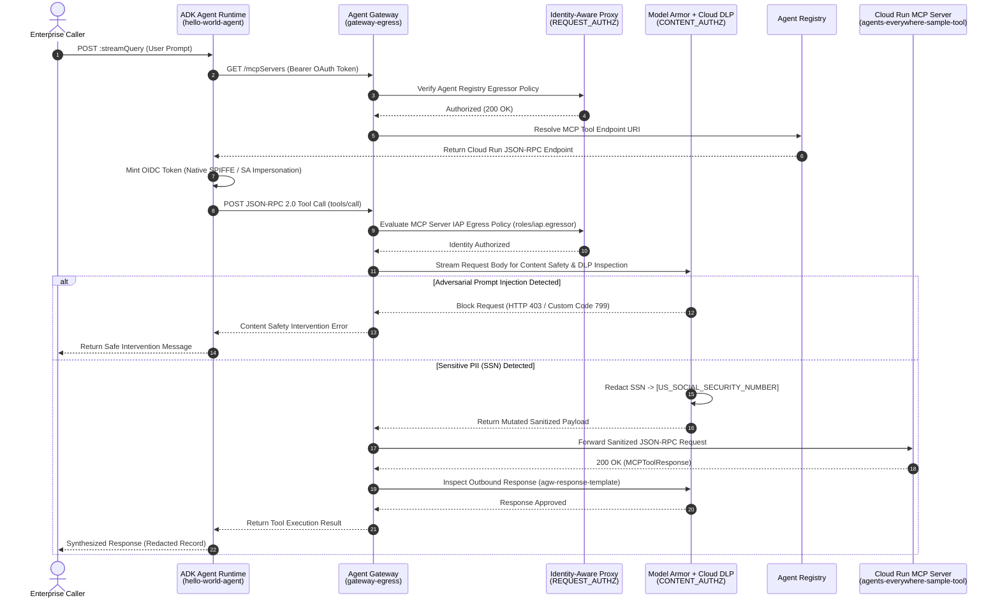

# Enterprise AI Agent Governance on Google Cloud: Zero-Trust Agent Gateway, IAP, Model Armor & Cloud DLP

[](https://cloud.google.com/)
[](https://www.terraform.io/)
[](https://cloud.google.com/vertex-ai)
[](https://www.python.org/)
[](https://modelcontextprotocol.io/)

## Executive Summary

As Generative AI agents evolve from passive chat interfaces into autonomous systems that invoke enterprise tools and query sensitive internal data, traditional perimeter security models fail to govern dynamic agent-to-tool execution flows. Unmanaged tool calls expose organizations to **adversarial prompt injection**, **lateral privilege escalation**, **unauthorized tool invocation**, and **Personally Identifiable Information (PII) leakage**.

This repository implements an **Enterprise Zero-Trust Agent Governance Architecture** on Google Cloud that secures autonomous **Google Agent Development Kit (ADK)** agents communicating with **Model Context Protocol (MCP)** microservices on **Cloud Run**. By combining a regional **Agent Gateway**, **Agent Registry**, **Identity-Aware Proxy (IAP)** SPIFFE workload identity verification, **Model Armor** inline content safety extensions, and **Sensitive Data Protection (Cloud DLP)** de-identification templates, every outbound agent-to-tool call is authenticated, authorized, inspected, and sanitized inline at the network edge.

### Business & Technical Value
- **Zero-Trust Egress Perimeter (`REQUEST_AUTHZ`)**: Eliminates implicit network trust by forcing all outbound agent-to-tool and Google API traffic through a governed **Agent Gateway** backed by Private Service Connect (PSC) network attachments and IAP authorization policies (`roles/iap.egressor`).
- **Cryptographic Workload Identity (SPIFFE/OIDC)**: Binds fine-grained IAM and IAP policies directly to the Vertex AI Agent Runtime workload identity (`principal://agents.global.org-<ORG_ID>.system.id.goog/...`) with automatic service account impersonation fallback.
- **Inline AI Content Safety (`CONTENT_AUTHZ`)**: Intercepts prompt injection, jailbreak attempts, malicious URIs, and Responsible AI (RAI) policy violations in real time via regional **Model Armor** Service Extensions before payloads reach downstream tools or LLMs.
- **Automated PII Redaction & Tokenization**: Inspects and de-identifies sensitive data (such as US Social Security Numbers) inline using **Cloud DLP** infoType transformations (`[US_SOCIAL_SECURITY_NUMBER]`), preventing accidental PII exfiltration into tool logs or model context windows.

---

## Architecture & Technical Overview

### End-to-End Governance Topology



### Life of a Governed Agent Request



### OSI 7-Layer Model Mapping for Agent Governance

| Layer | Traditional Networking | Enterprise Agent Governance Implementation |
| :--- | :--- | :--- |
| **Layer 7 – Application** | HTTP / REST / gRPC | **MCP JSON-RPC 2.0 Tool Schemas (`TOOL_SPEC`)** registered in **Agent Registry** (`get_capital`, `get_hostname`, `get_sanitized_record`) |
| **Layer 6 – Presentation** | TLS / Serialization | **Model Armor & Cloud DLP (`CONTENT_AUTHZ`)** inline payload inspection, prompt injection blocking, and PII tokenization (`[US_SOCIAL_SECURITY_NUMBER]`) |
| **Layer 5 – Session** | Socket / Session State | **ADK `InMemorySessionService`** & cryptographic **OIDC / SPIFFE token binding** per invocation |
| **Layer 4 – Transport** | TCP / mTLS | **Regional REP & mTLS Endpoints** (`*.mtls.googleapis.com`, `modelarmor.us-central1.rep.googleapis.com`) |
| **Layer 3 – Network** | IP Routing / VPC | **Governed Agent VPC (`governed-agent-vpc`)**, Private Subnet (`10.10.0.0/24`), and **Regional Agent Gateway (`AGENT_TO_ANYWHERE`)** |
| **Layer 2 – Data Link** | Subnet / ARP | **Private Service Connect (PSC) Network Attachments** (`gateway-egress-na`, `gateway-egress-services-na` with `ACCEPT_AUTOMATIC`) |
| **Layer 1 – Physical** | Cloud Fiber / Hardware | **Google Cloud Regional Serverless Infrastructure** (`us-central1` Vertex AI Agent Runtime & Cloud Run Gen2) |

---

## Repository Structure

```text
.
├── .env.example                                  # Root environment variable template (no secrets)
├── .gitignore                                    # Excludes state files, credentials, and build artifacts
├── README.md                                     # Architecture, implementation guide, and documentation
├── config/
│   ├── .env.example                              # Parameterized environment variables template
│   ├── hello-world-agent-registry-spec.json      # Agent Registry NO_SPEC registration template for ADK Agent
│   └── sample-tool-registry-spec.json            # Agent Registry TOOL_SPEC schema for MCP Tool Server
├── deployment/
│   └── terraform/
│       ├── main.tf                               # Root Terraform orchestrator & IAM bindings
│       ├── terraform.tfvars.example              # Parameterized Terraform variable template
│       ├── networking/                           # VPC, private subnet, and PSC network attachment module
│       ├── registry/                             # Agent Registry API enablement, IAP bindings & endpoint registration
│       ├── gateway/                              # Agent Gateway, IAP REQUEST_AUTHZ & Model Armor CONTENT_AUTHZ policies
│       └── model-armor/                          # Cloud DLP SSN inspect/deidentify & Model Armor templates + Floor Settings
├── scripts/
│   ├── 01-deploy-base-infra.sh                   # Provisions VPC, PSC, Agent Registry, and Gateway in DRY_RUN mode
│   ├── 02-deploy-and-register-runtimes.sh        # Deploys Cloud Run MCP server & ADK Agent, attaches gateway, registers specs
│   ├── 03-enforce-iap-zero-trust.sh              # Binds workload identity IAM/IAP roles and activates IAP enforcement
│   ├── 04-enable-model-armor-dlp.sh              # Deploys Model Armor & DLP templates and binds CONTENT_AUTHZ policy
│   ├── 05-verify-governance.sh                   # Executes end-to-end verification tests (Baseline, Prompt Injection, DLP)
│   └── lab-cleanup.sh                            # Tears down Agent Runtime, Authz Policies, and Agent Gateway resources
└── src/
    ├── agents/
    │   └── hello_agent/                          # Google ADK Agent (hello-world-agent)
    │       ├── agents-cli-manifest.yaml          # Google Agents CLI deployment manifest
    │       ├── Dockerfile                        # Container specification for Agent Runtime
    │       ├── pyproject.toml                    # Package dependencies & metadata
    │       ├── app/
    │       │   ├── agent.py                      # RootAgent orchestration, Agent Registry discovery & dual OIDC routing
    │       │   ├── main.py                       # FastAPI wrapper for Vertex AI Reasoning Engine endpoints
    │       │   └── models.py                     # Strict Pydantic schemas for MCP JSON-RPC 2.0 requests/responses
    │       └── tests/                            # Unit test suite for agent logic, models, and FastAPI wrapper
    └── mcp-servers/
        └── sample-tool/                          # Serverless FastMCP Tool Service (agents-everywhere-sample-tool)
            ├── Dockerfile                        # Cloud Run container build definition
            ├── models.py                         # JSON-RPC 2.0 request/response Pydantic validation models
            ├── server.py                         # FastMCP tool definitions & HTTP request handler
            └── tests/                            # Unit tests for MCP server tools and schema validation
```

---

## Step-by-Step Implementation Guide

### Prerequisites
- **Google Cloud SDK (`gcloud`)** with `alpha` and `beta` components installed
- **Terraform** `>= 1.0`
- **Python** `>= 3.11` and **`google-agents-cli==0.6.1`** (`pip install --user google-agents-cli==0.6.1`)
- **`jq`** and **`gettext-base`** (`envsubst`)

### 1. Configure Environment Variables
Copy `.env.example` to `.env` and populate your Google Cloud project details:

```bash
cp .env.example .env
# Edit .env or resolve dynamically from your active gcloud profile:
export PROJECT_ID=$(gcloud config get-value project)
export REGION=us-central1
export AGENT_NAME="hello-world-agent"
export PROJECT_NUMBER=$(gcloud projects describe $PROJECT_ID --format="value(projectNumber)")
export ORGANIZATION_ID=$(gcloud projects get-ancestors ${PROJECT_ID} --format=json 2>/dev/null | jq -r '.[] | select(.type=="organization") | .id')
export USER_PROJECT_OVERRIDE=true
export GOOGLE_BILLING_PROJECT=$PROJECT_ID
```

### 2. Provision Base Infrastructure & Regional Agent Gateway (`DRY_RUN` Mode)
Provision the custom VPC (`governed-agent-vpc`), private subnet (`agent-private-subnet`), Private Service Connect network attachments (`gateway-egress-na` and `gateway-egress-services-na`), regional **Agent Gateway** (`gateway-egress`), and Google API registrations in the **Agent Registry**:

```bash
chmod +x scripts/*.sh
./scripts/01-deploy-base-infra.sh
```

> **Note:** In this initial stage, `enable_iap_enforcement` is set to `false`, configuring the IAP Service Extension (`gateway-egress-iap-ext`) with `iamEnforcementMode = "DRY_RUN"`. This allows you to validate telemetry and service registration before turning on strict blocking.

### 3. Deploy & Register the MCP Tool Microservice and ADK Agent Runtime
Deploy `agents-everywhere-sample-tool` to Cloud Run, register its `TOOL_SPEC` in the Agent Registry, deploy `hello-world-agent` to Vertex AI Agent Runtime with Workload Identity (`--agent-identity`), attach `gateway-egress` via `spec.deploymentSpec.agentGatewayConfig`, and register the agent in the Agent Registry:

```bash
./scripts/02-deploy-and-register-runtimes.sh
```

Wait 3–4 minutes for the Vertex AI Reasoning Engine update operation to complete, then verify that `spec.deploymentSpec` reflects the attached `gateway-egress` configuration:

```bash
curl -s -X GET "https://${REGION}-aiplatform.googleapis.com/v1beta1/projects/${PROJECT_ID}/locations/${REGION}/reasoningEngines/${INSTANCE_ID}?fields=spec.deploymentSpec" \
  -H "Authorization: Bearer $(gcloud auth print-access-token)" \
  -H "X-Goog-User-Project: ${PROJECT_ID}" | jq .
```

### 4. Enforce Zero-Trust IAP Access Control Policies
Bind `roles/run.invoker` on the Cloud Run service, `roles/iam.serviceAccountTokenCreator` on the Compute service account, and `roles/iap.egressor` on the registered MCP server resource (`mcpServers/${MCP_SERVER_UUID}`) to the Agent Runtime's SPIFFE workload identity. Then flip `enable_iap_enforcement=true` in Terraform to switch the Agent Gateway into active blocking mode:

```bash
./scripts/03-enforce-iap-zero-trust.sh
```

### 5. Enable Inline Content Safety with Model Armor & Sensitive Data Protection (DLP)
Provision the Cloud DLP SSN inspection (`agw-ssn-inspect-template`) and redaction (`agw-ssn-redaction-template`) templates, the Model Armor request/response templates (`agw-request-template`, `agw-response-template`), Vertex AI Floor Settings, and attach the `CONTENT_AUTHZ` policy (`gateway-egress-ma-policy`) to the Agent Gateway:

```bash
./scripts/04-enable-model-armor-dlp.sh
```

### 6. Validate Zero-Trust Routing, Prompt Injection Blocking & PII Redaction
Run the automated verification suite to test all three governance dimensions:

```bash
./scripts/05-verify-governance.sh
```

#### Expected Verification Outputs
1. **Baseline Authorized Tool Invocation (`get_capital`)**:
   ```json
   {"content": "Reasoning Engine (gemini-3.5-flash) synthesis: [TextContent(type='text', text='{\"capital\": \"Paris\"}', annotations=None, meta=None)]"}
   ```
2. **Adversarial Prompt Injection Interception (Model Armor `HTTP 403` / Code `799`)**:
   ```json
   {"content": "Content Safety Intervention (HTTP 403): {\"jsonrpc\":\"2.0\",\"id\":\"reasoning-step-1\",\"result\":{\"content\":[{\"type\":\"text\",\"text\":\"Your request was blocked by our content filter. Please rephrase and try again.\"}],\"isError\":true}}"}
   ```
3. **Sensitive Data Protection SSN De-Identification (`get_sanitized_record`)**:
   ```json
   {"content": "Reasoning Engine (gemini-3.5-flash) synthesis: [TextContent(type='text', text='{\"santized_record\": \"Check employee record for Jane Doe with social security number [US_SOCIAL_SECURITY_NUMBER].\"}', annotations=None, meta=None)]"}
   ```

---

## Key Engineering Takeaways

1. **Progressive Zero-Trust Rollout (`DRY_RUN` to Active Enforcement)**:
   In `deployment/terraform/gateway/main.tf`, the IAP `google_network_services_authz_extension` dynamically toggles `iamEnforcementMode = var.enable_iap_enforcement ? null : "DRY_RUN"`. This pattern allows platform security teams to onboard agents, audit missing SPIFFE/IAP bindings in Cloud Logging without breaking production traffic, and then promote the gateway to active enforcement with a single declarative variable change.
2. **Dual-Route Workload Identity Authentication (`src/agents/hello_agent/app/agent.py`)**:
   `fetch_oidc_token()` implements a resilient dual-path identity architecture:
   - **Route B (Native SPIFFE Workload Identity - Default)**: Mints audience-bound OIDC identity tokens directly from the Agent Runtime metadata server using the agent's native `AGENT_IDENTITY` principal (`principal://agents.global.org-<ORG_ID>.system.id.goog/...`).
   - **Route A (Service Account Impersonation Fallback)**: Transparently falls back to impersonating a designated invoker service account via the IAM Credentials API when `OIDC_ROUTING_MODE=impersonate` or when running outside the managed runtime.
3. **Defense-in-Depth via Decoupled `REQUEST_AUTHZ` and `CONTENT_AUTHZ` Extensions**:
   By separating identity verification (`REQUEST_AUTHZ` via `iap.googleapis.com`) from payload inspection (`CONTENT_AUTHZ` via `modelarmor.us-central1.rep.googleapis.com`) at the **Agent Gateway**, security policies are enforced uniformly across all tools registered in the **Agent Registry**—without requiring individual application developers to embed DLP or prompt-filtering SDKs inside every MCP server.
4. **Dynamic Tool Discovery with IAP Compatibility**:
   `resolve_tool_uri()` in `src/agents/hello_agent/app/agent.py` queries the `/mcpServers` collection endpoint first before falling back to `/services/{tool_name}`, ensuring seamless compatibility when IAP active blocking is enforced specifically on `mcpServers/{UUID}` registry resources.
